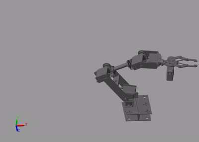
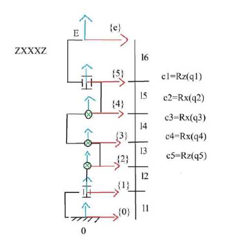
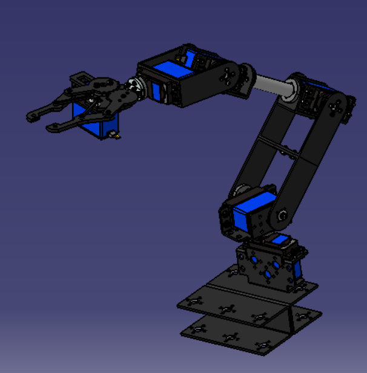
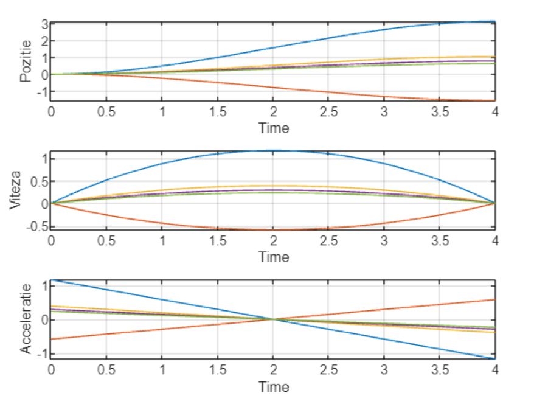
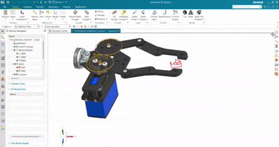
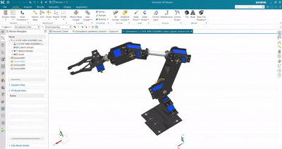

# Simulation of a Robotic Arm - Pick and Place

## Overview
This project presents the simulation of a "Pick and Place" task for a robotic arm, aiming to move the end effector from point A (pickup) to point B (placement). The simulation integrates mathematical trajectory planning using polynomial interpolation and explores six distinct control and dynamic analysis methods within the MATLAB and Simulink environment

  

## Features
- Motion planning through 3rd-order polynomial interpolation, ensuring zero velocity and acceleration at the trajectory ends (0 and 4 seconds).
- Synchronized movement for all robotic arm joints.
- Kinematic configuration modeled with 5 degrees of freedom (DoF) as a Z-X-X-X-Z serial chain.
- Direct import and manipulation of CAD reference frames from .CATPart files into Simulink.
- Simulation architecture branched into 6 methods, including classic control with gear-motor models, PID control, and a "Phantom Model" method that directly integrates dynamic models (forward and inverse) to avoid explicit calculation of inertia and Coriolis matrices.

  

## Methods
The project explores six distinct simulation methods to validate the control architecture and kinematic models.

* **Method 1 (Direct Kinematics to Torque):** Inputs kinematic parameters (position, velocity, acceleration) directly into the joints to output the required torque
* **Method 2 (Torque to Position):** The reverse of Method 1; inputs torque to calculate the physical positional response (noted to cause an unstable "helicopter effect" during testing).
* **Method 3 (Motor-Reducer Models):** Introduces motor-reducer models where calculated torques act as external loads, simulating the real effort required to overcome inertia and the arm's weight using PID.
* **Method 4 (Phantom Model):** Runs forward and inverse dynamic models simultaneously to eliminate the need for explicit inertia, Coriolis, and gravitational matrix calculations, using a P-controller.
* **Method 5 (Direct Acceleration):** A variation of the Phantom Model that directly integrates acceleration from the summation point.
* **Method 6 (PID Control):** Utilizes a PID regulator focusing strictly on correlating the system's positional response with the execution time window.

## Technologies Used

- Software & Tools: MATLAB, Simulink, Simscape (for PS-Simulink and Simulink-PS conversions)
- CAD Formats: .CATPart (imported via File Solid blocks)

  

## Architecture

The open-source visual model is built at a 1:1 scale compared to the physical arm. The mechanical architecture was reproduced by breaking down the CAD model into individual parts, which were then assembled in Simulink by matching reference frames (Frames) and using Rigid Transform blocks to properly align the rotation axes with the simulator's Z-axis. The global frame and gravity are controlled through fundamental modules: World Frame, Mechanism Configuration, and Solver Configuration. The system transfers data (position, velocity, acceleration) calculated in a MATLAB script directly into Simulink blocks (via From Workspace), which in turn dictate joint movement or motor effort, and the calculated torques are sent back to MATLAB (via To Workspace).

  

## Results

- The first method successfully generated the necessary joint torques by directly imposing the position, velocity, and acceleration profiles.
- It was observed that imposing torques as input (second method) caused an unstable behavior described as a "helicopter effect".
- Advanced solutions (Phantom Model) managed to maintain stability and accuracy, albeit at the cost of introducing considerable noise on the velocity, acceleration, and error signals.
- For optimization and reduction of high-frequency fluctuations, the study proposes integrating digital filters (LowPass) or a Kalman filter.
- A minor geometric modeling error was identified, where certain assembly elements (screws) rotate with the joints in the virtual environment instead of remaining fixed relative to the structure.

## Simcenter3D

To better visualize the robot, it was also simulated in **Simcenter3D**. Below are the animations demonstrating the synchronized movement of the robotic arm in action.

  

  

## Documentation

For a detailed explanation of the design process, methodology, calculations, and results, see the project documentation and presentation below.

[Presentation](6DOF%20robot%20imported%20in%20simulink/Practica_De_Cercetare_Condrea_Laurentiu_%20Complet.pptx)

